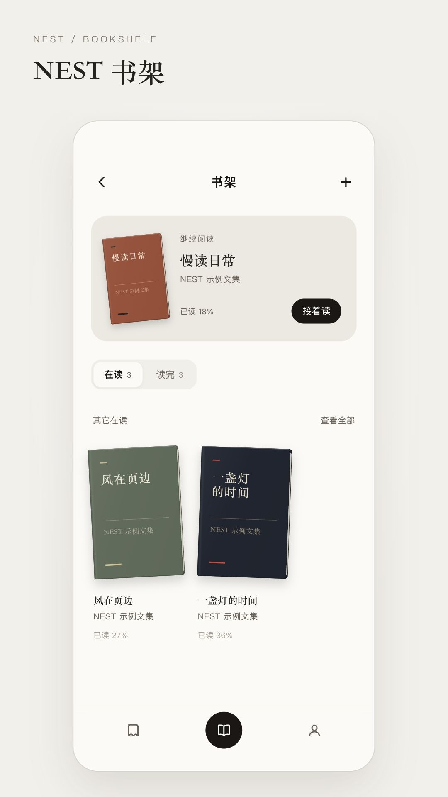

# NEST 书架

纸感书封、自己的阅读节奏，以及留在页边的想法。



[观看／下载 22 秒动态演示](demo.mp4) · 1080 × 1920 · 原创电子配乐

NEST 新版书架的独立前端演示。使用 React 18，示例书籍、正文和批注均为演示数据；导入与编辑保存在当前浏览器。

## 打开

下载本仓库后直接打开 `index.html`，无需账号或构建。也可在目录运行 `python3 -m http.server 8080`，访问 `http://localhost:8080`。建议使用本地服务：不同浏览器对 `file://` 下的存储支持不同。

## 可以体验

- **书架**：硬板书封、继续阅读卡片、在读／读完切换、全部书籍与搜索。
- **阅读**：左右翻页或上下滚动，字号与五种阅读外观，目录、页码跳转与位置记忆。
- **批注**：点段落或选中文字高亮，写笔记、回复、修改颜色，在书籍详情搜索批注。
- **整理**：重命名、阅读状态、完成日期、书签汇总与阅读统计。
- **导入**：EPUB、文字层 PDF、TXT、HTML、目录文件与粘贴文字。

这是本地前端演示，不含账号、服务端或多人实时同步。示例中的“同伴”只是用于展示作者区分；回复仍写入本地。

## 修改界面

`bookshelf.jsx` 是可编辑源文件，包含数据适配、书架、详情、阅读器、批注和根路由。`index.html` 包含样式、解析器、带许可声明的运行依赖和已编译代码。这样下载单个 HTML 也能直接体验。

```sh
npm install
npm run build
```

构建只更新 HTML 中的 `bookshelf-app` 脚本。样式和导入解析逻辑在 `index.html` 中修改。无需提交 `node_modules`。

## 给开发者与 AI 的接入说明

沿用现有组件与设计变量，不要重新设计整套界面。`BookCover` 负责书封；`ShelfView` / `BookDetailView` 负责书架和详情；`ReaderView` 以段落索引和段内偏移保存阅读位置；`ReaderParagraph` 用 `rangeStart` / `rangeEnd` 绘制高亮；`AnnotationSheet` 负责批注和回复。

`BOOKS` 是当前内存数据，入口处的本地适配函数是接入自己存储的边界：`bookById`、`persistShelf`、`addUserBook`、`renameBook`、`removeBook`、`upsertUserAnnotation`、`removeUserAnnotation`、`appendReply`。书籍正文放在 `text[0].paragraphs`，目录项的 `paraIdx` 对应段落索引。批注包含段落索引、段内字符范围、颜色、作者、日期和回复列表。不要把屏幕分页号当作稳定定位：改变字号或宽度就会重新分页。

演示以 localStorage 保存数据，适合少量文本。大量电子书请换成 IndexedDB 或自有服务端，并处理配额、备份、鉴权和冲突。清除浏览器站点数据会删除本地书籍与批注。删除书籍会同时删除该书本地批注。

点击与输入聚焦不额外添加灰色遮罩，正常文字选区保留；颜色选择用细描边，不用勾号。静态卡片底色和功能性分段选中态保留。尊重 `prefers-reduced-motion`。

## 网络与格式边界

首屏、阅读、批注、EPUB 和文字导入不需要网络。首次导入 PDF 时，按需从 unpkg 加载 PDF.js 及字体映射资源；文件内容在浏览器内解析，不上传。扫描 PDF 没有文字层时无法直接导入；复杂排版、公式、脚注及图片不会完整保留。本演示是文字阅读器，不是原版式电子书渲染器。

## 许可

与本账号已有项目保持一致，使用仓库中的个人非商业许可证：保留署名，仅限个人非商业使用和修改，不允许公开再分发或改用更宽松的许可。**这是源码公开项目，不是 OSI 定义的开源许可证。** 第三方组件各自遵循原许可证，见 `THIRD_PARTY_NOTICES.md`。
