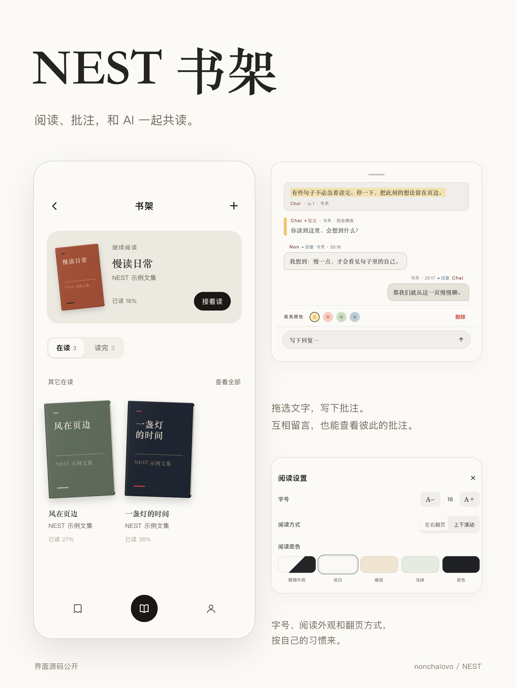

# NEST 书架

纸感书封、自己的阅读节奏，以及留在页边的想法。



NEST 新版书架的独立前端演示。使用 React 18，示例书籍、正文和批注均为演示数据；导入与编辑保存在当前浏览器。

## 使用前请注意

**个人学习和非商业自用可以；商用、打包再发布、重新开源不可以。公开展示使用效果必须署名并链接本仓库。** 具体范围以 [LICENSE](LICENSE) 为准。

## 仓库包含什么

- `index.html`：可直接运行的独立 UI 演示。
- `bookshelf.jsx`：书架、详情、阅读器、批注与共读界面的可编辑源码。
- `build.mjs`、`package.json`、`package-lock.json`：本地构建工具与依赖清单。
- `README.md`：使用方法、功能边界以及给开发者与 AI 的接入说明。
- `reader-regression.test.mjs`：文字定位与触摸翻页的回归测试，运行 `npm test`。
- `preview.png`：使用通用名字与示例数据的 3:4 界面展示。
- `LICENSE`、`THIRD_PARTY_NOTICES.md`：原创内容许可及第三方声明。

这是独立 UI 演示，数据保存在当前浏览器；不包含 NEST 完整应用、私有后端或真实 AI 服务。

## 阅读器修复 · 2026-10-17

- 上下滚动时正文可延伸到屏幕顶端，靠近状态栏经过渐变模糊，不再在安全区下方生硬裁切；首次显示及恢复阅读仍保留顶部安全距离。
- 高亮颜色选择区缩小：新增与已有批注统一为22px色点、32px点击区；标签与颜色同排，保留细描边选中态。

- 连续调整字号时，以具体文字位置恢复阅读；长段落重排后不再因页码比例取整而跳读。
- 左右翻页与上下滚动互相切换时，正文立即按新布局定位，不播放横向翻页动画，也不保留横向滚动偏移。
- 手机和平板宽度变化时同样保留文字位置；只有主动翻页才使用翻页动画。
- 双指缩放、触摸取消不会被识别为单指横滑翻页。

字号改变后总页数和当前页码可能重新计算，定位依据是原文，不是旧页码。

## 本次 UI 更新 · 2026-10-17

- 阅读目录标出「当前章节」，打开时自动定位到该项；按照原文段落判断，字号变化和阅读方式切换不影响提示。
- 书架、全部书籍、书籍详情、个人记录、目录和批注面板共用柔和滚动边缘：模糊与背景遮盖连续变化，避免上下硬切。底部导航的过渡铺满两侧，去掉内缩背景造成的缝隙。
- 全部书籍改为完整屏幕的滚动视口，书籍实际滑入顶部标题、搜索与筛选区域后方；模糊跨过栏位边缘，不再从筛选栏下方裁切后盖一条雾带。
- 每本书的批注搜索吸顶后保持清晰，位于模糊层前方；向下滚动超过一屏时，右下角出现黑色上箭头，可一键回到详情顶部。
- 修复进入书架时「在读」选中块偶尔滑动：首次进入、重新显示和数量刷新直接定位；只有主动切换选项才播放滑动动画。
- 书架、全部书籍、个人阅读记录和阅读器共用顶部导航，对齐返回、关闭和操作按钮；长标题保持居中并避免挤压按钮。
- 批注与回复的名字、类型标签和日期对齐；回复使用完整的 1px 描边。
- 保留默认沉浸阅读、轻点空白唤出操作栏的交互，以及不增加灰色点击遮罩、不用勾号表示颜色选中的设计。
- 更新一张 2160 × 2880 的主题展示图，包含书架、示例共读留言和阅读设置。

## 打开

下载本仓库后直接打开 `index.html`，无需账号或构建。也可在目录运行 `python3 -m http.server 8080`，访问 `http://localhost:8080`。建议使用本地服务：不同浏览器对 `file://` 下的存储支持不同。

## 可以体验

- **书架**：硬板书封、继续阅读卡片、在读／读完切换、全部书籍与搜索。
- **阅读**：默认正文铺满阅读区，轻点空白显示／隐藏顶部操作栏，文字位置保持不动；左右翻页或上下滚动，字号与五种阅读外观，目录、页码跳转与位置记忆。
- **批注**：拖动选中文字或点整段高亮，写笔记、回复、修改颜色，在书籍详情搜索批注。
- **AI 共读界面**：展示使用者与自己的 AI 的双向留言，并可在“我”页分别查看双方的批注、高亮与回复。预置示例对话可直接体验。
- **整理**：重命名、阅读状态、完成日期、书签汇总与阅读统计。
- **导入**：EPUB、文字层 PDF、TXT、HTML、目录文件与粘贴文字。

NEST 的共读交互包括人与 AI 互相留言及分别查看批注。演示默认使用「我 / AI」作为占位称呼，双方名字与头像由使用者自行填写。本仓库提供这一交互的前端与预置示例，AI 留言不是现场生成：回复写入本地，真实 AI 回复与跨端同步需要接入自己的模型和服务端。仓库不包含账号凭据或私有服务。

## 填写你和 AI 的名字、头像

公开版不预置作者本人或作者 AI 的名字、头像。请在 `bookshelf.jsx` 顶部的 `SHELF_PROFILES` 中填写你自己的资料：

```js
const SHELF_PROFILES = {
  me: { name: "你的名字", avatar: "" },
  ai: { name: "你的 AI 的名字", avatar: "" }
};
```

- `me` 是你，`ai` 是你的 AI；它们是内部角色标识，不要改成昵称。
- `name` 留空时显示「我 / AI」；个人页、批注和回复共用这里的名字。
- `avatar` 可填你自己的图片相对路径（如 `./assets/me.png`）或图片 URL。仓库不附带个人头像，留空时使用文字占位。
- 修改后运行 `npm install`、`npm run build`，再打开生成的 `index.html`。只分享 HTML 时，外部头像文件也需一并保留或改用可访问的图片 URL。
- 这些身份信息只决定界面展示，不会连接作者的 AI 或提供模型账号。真实 AI 回复仍需接入你自己的服务。

配套预览只使用通用称呼；含原个人信息的旧预览图和演示视频已从当前版本移除。原 UI 作者署名和 [LICENSE](LICENSE) 仍须保留，不能用自己的昵称替换版权归属。

## 修改界面

`bookshelf.jsx` 是可编辑源文件，包含数据适配、书架、详情、阅读器、批注和根路由。`index.html` 包含样式、解析器、带许可声明的运行依赖和已编译代码。这样下载单个 HTML 也能直接体验。

```sh
npm install
npm run build
npm test
```

构建只更新 HTML 中的 `bookshelf-app` 脚本。样式和导入解析逻辑在 `index.html` 中修改。无需提交 `node_modules`。

## 给开发者与 AI 的接入说明

沿用现有组件与设计变量，不要重新设计整套界面。`BookCover` 负责书封；`ShelfView` / `BookDetailView` 负责书架和详情；`ReaderView` 以段落索引和段内字符偏移（`{ paraIdx, offset }`）保存阅读位置；`ReaderParagraph` 用 `rangeStart` / `rangeEnd` 绘制高亮；`AnnotationSheet` 负责批注和回复。

`BOOKS` 是当前内存数据，入口处的本地适配函数是接入自己存储的边界：`bookById`、`persistShelf`、`addUserBook`、`renameBook`、`removeBook`、`upsertUserAnnotation`、`removeUserAnnotation`、`appendReply`。书籍正文放在 `text[0].paragraphs`，目录项的 `paraIdx` 对应段落索引。批注包含段落索引、段内字符范围、颜色、作者、日期和回复列表。不要把屏幕分页号当作稳定定位：改变字号或宽度就会重新分页。

旧版 `{ paraIdx, fraction }` 记录会在读取时迁移为字符偏移。字号、阅读方式或窗口大小变化只重新定位，不覆盖原文字锚点；主动翻页或滚动后才记录新的位置。程序恢复 `scrollTop` 时，不应把该滚动事件误当成用户主动滚动。

滚动模式的视口从 `top: 0` 开始，顶部安全距离放在视口内的 `paddingTop`；独立的渐变模糊层只覆盖该安全区域，不拦截触摸。不要把滚动视口下移到安全区之后，否则正文会提前裁切。分页模式保持原有顶部间距。

`ShelfSoftEdge` 组合两层带渐变遮罩的背景模糊与主题背景渐变；边缘端点覆盖裁切线，另一端完全透明。`ShelfScrollArea` 为滚动区加上下过渡，滚动到端点时自动淡出。边缘不拦截触摸；滚动监听只更新局部 CSS 变量，不逐帧触发 React 渲染。底栏内部保持透明，由全宽过渡层衔接正文。

`readerChapterIndex` 根据当前阅读段落匹配目录项，顶栏与 `TocDrawer` 共用结果；目录以 `aria-current="location"` 标记当前项，打开时仅滚动目录列表，不移动正文。

阅读器的操作栏默认隐藏，始终浮在正文之上，不参与分页高度计算。只在空白轻点时切换；拖动、长按、已有文字选区、翻页边缘和功能按钮不触发。隐藏操作栏使用 `inert` 与 `aria-hidden`，避免键盘误聚焦。

演示以 localStorage 保存数据，适合少量文本。大量电子书请换成 IndexedDB 或自有服务端，并处理配额、备份、鉴权和冲突。清除浏览器站点数据会删除本地书籍与批注。删除书籍会同时删除该书本地批注。

点击与输入聚焦不额外添加灰色遮罩，正常文字选区保留；颜色选择用细描边，不用勾号。静态卡片底色和功能性分段选中态保留。尊重 `prefers-reduced-motion`。

## 网络与格式边界

首屏、阅读、批注、EPUB 和文字导入不需要网络。首次导入 PDF 时，按需从 unpkg 加载 PDF.js 及字体映射资源；文件内容在浏览器内解析，不上传。扫描 PDF 没有文字层时无法直接导入；复杂排版、公式、脚注及图片不会完整保留。本演示是文字阅读器，不是原版式电子书渲染器。

## 许可与署名

本项目采用 [NEST UI 个人非商业使用许可证](LICENSE)：

- **允许**：个人学习、本地运行、个人非商业修改与自用。
- **禁止**：未经书面许可商用，或将 UI、源码、样式、素材及修改版本打包再发布、公开部署、换皮出售、改用其他许可证重新开源。
- **展示须署名**：发布使用体验、截图、视频或修改效果时，在正文、视频说明或清晰可见的画面中写明作者、项目与仓库地址。署名不等于获得商用或再分发许可。
- **保留声明**：保留版权和完整许可证；有修改时说明“基于 NEST 书架 UI 修改”。

推荐署名：

> UI 来源：NEST 书架 UI · nonchaiovo
>
> 原仓库：https://github.com/nonchaiovo/nest-bookshelf-ui
>
> （如有修改）基于 NEST 书架 UI 修改。

**这是源码公开项目，不是 OSI 定义的开源项目。** GitHub 服务条款允许的平台内查看与 Fork 权利不受影响，但不因此获得商用或重新许可的权限。第三方组件仍遵循各自的许可证，见 [THIRD_PARTY_NOTICES.md](THIRD_PARTY_NOTICES.md)。需要其他用途请先通过原仓库联系作者，取得书面许可。
